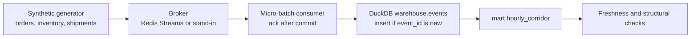
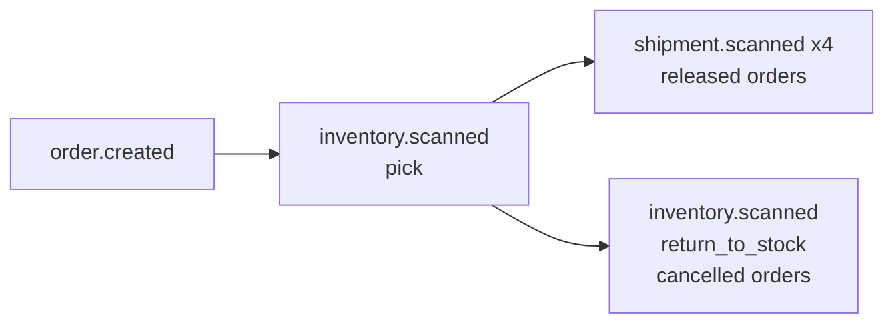
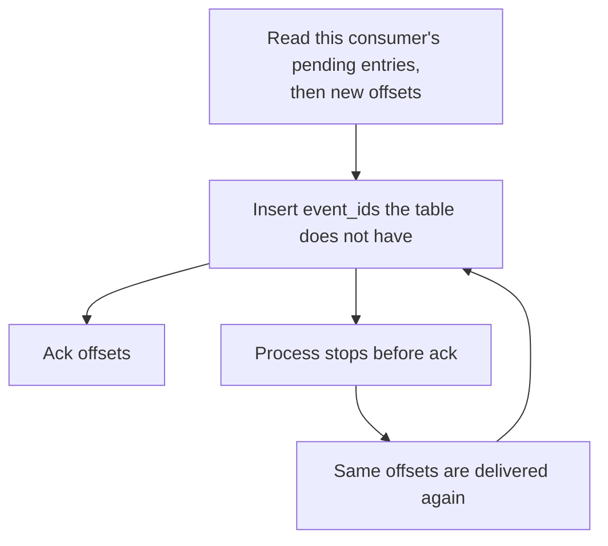

# Andén Sur streaming warehouse

**Site:** https://eflores1122.github.io/streaming-events-warehouse/

Reference implementation by **Edgar Flores**, Data & AI Engineer (Mexico).

This repository is a streaming reference for **Andén Sur**, a fictitious Mexican e-commerce fulfillment floor. It receives retail orders, scans inventory on the pick face, and scans shipments as cartons move between hubs. A Python generator publishes JSON events, a consumer micro-batches them, and DuckDB keeps one row per `event_id`.

Andén Sur is not a real company. Nothing here describes an employer, a client, or a production system. Orders, inventory scans, shipment scans, hubs, and customer references are synthetic. The pipeline does not call GCP or AWS.

No GCP project and no credentials are required.

## What runs locally

| Piece | Local / CI | Production-shaped target |
| --- | --- | --- |
| Browser page | [GitHub Pages](https://eflores1122.github.io/streaming-events-warehouse/). DuckDB-WASM and the in-memory stand-in. | Same generator and the same `event_id` insert. Not a broker and not BigQuery. |
| Events | Synthetic generator, fixed epoch, seed 42 | A real order, inventory, and shipment feed. Not this repository. |
| Broker | Redis Streams when you run Compose or `--broker redis`. The default smoke test uses the stand-in. | Kafka, Redpanda, or Pub/Sub. Same contract: read, process, ack. |
| Consumer | Micro-batches. Ack runs after the DuckDB commit. | The same ack-after-commit rule. |
| Warehouse | DuckDB file. Primary key `event_id`. | BigQuery, partitioned by `DATE(event_time)`, clustered by `event_type`. |
| Dedup | Insert only when `event_id` is new. | `MERGE` on `event_id` after a Storage Write API committed stream. |
| Late events | Flagged against the stream watermark minus 6 hours, and kept. | The same flag. Closing a partition would be a later policy. |
| Catch-up | JSONL archive replay, plus an optional Airflow DAG. CI does not install Airflow. | The same tasks. |
| Credentials | None. | Not used here. |

Redis Streams is the Compose broker because consumer groups, pending entries, and ack are server features, and the Python client does not need a native library. CI starts Redis 7 as a service and also runs the smoke test with no broker process. The stand-in is that process-free path. It is labeled in the demo output as `stand-in (local consumer-group stand-in; not Redis Streams and not Kafka)`. Redpanda or Kafka would sit behind the same read/ack contract. This repository does not ship a Kafka client.

The BigQuery statements in [`src/andensur/sql/bigquery_events.sql`](src/andensur/sql/bigquery_events.sql) are a target shape. Nothing in the demo, the browser page, or CI executes them.

The browser page runs a JavaScript port of `build_events`. CI diffs that JSONL against `python -m andensur generate`. The page then micro-batches into DuckDB-WASM with the same insert rule as `warehouse.py`: the first `event_id` wins, a row is late against the watermark minus 6 hours, and you can query the tables. Redis, BigQuery, and the Airflow DAG stay off the page. The reference counts below are still the CLI measurement.

## Architecture



One released order, in publish order. The broker does not reorder by `event_time`.



At-least-once delivery. The warehouse primary key is what makes a replay safe.



## Reference run

Seed `42`, `120` orders. Counts do not depend on the seed. The seed changes amounts and `Sintetico######` customer references only. Reproduce with the commands in [How to run](#how-to-run).

| | |
| --- | ---: |
| Orders | 120 |
| Cancelled orders (`i % 10 == 0`, including order 0) | 12 |
| Released orders | 108 |
| Inventory scans (120 picks plus 12 returns) | 132 |
| Shipment scans | 432 |
| Unique events | 684 |
| Published, including 4 exact replays | 688 |
| Warehouse rows after dedup | 684 |
| Duplicates dropped | 4 |
| Late rows | 3 |
| Rejects | 0 |
| `mart.hourly_corridor` rows | 53 |

A second `demo --no-fresh` against the same files publishes 688 again, inserts 0, reports 688 duplicates, and leaves 684 rows.

`order.created` is 120, `inventory.scanned` is 132, and `shipment.scanned` is 432. The 53 hourly mart rows sum back to 684 events and to the 3 late rows.

## Sample event

The first event is order 0. It is cancelled before it leaves the building, so the pick goes back to the bin and there is no shipment.

```json
{
  "event_id": "evt-ord-00000",
  "event_type": "order.created",
  "event_time": "2026-11-02T14:00:00Z",
  "source": "andensur-synthetic",
  "payload": {
    "amount_centavos": 19200,
    "channel": "online",
    "fulfillment": "cancelled",
    "city": "Ciudad de Mexico",
    "currency": "MXN",
    "customer_ref": "Sintetico042000",
    "order_id": "ORD-20261102-00000",
    "sku_count": 1,
    "state": "CDMX"
  }
}
```

`19200` centavos is 192.00 MXN of merchandise on the order. Amounts are whole pesos, `15000 + ((seed + index * 97) % 4000) * 100`.

## Broker

Both backends expose `publish`, `ensure_group`, `read`, and `ack`.

| | Redis Streams | Stand-in |
| --- | --- | --- |
| Where | `docker compose`, or `--broker redis` | default `--broker stand-in` |
| Group | `XGROUP CREATE ... ID 0` | cursor stored in `state.json` |
| Pending | `XREADGROUP` id `0`, then `XAUTOCLAIM` | this consumer's pending list, then idle claim |
| New records | `XREADGROUP` id `>` | offsets at the cursor |
| Dedup of `event_id` | no | no |

The group is created at id `0`, so a group created after the first `XADD` still sees those entries. `--fresh` deletes the Redis key `andensur.events` and only that key. The stream name, group, and consumer are `andensur.events`, `andensur-warehouse`, and `warehouse-1`.

The stand-in writes `messages.jsonl` plus `state.json` under the directory you pass as `--standin-root`. An `fcntl` lock lets a producer process and a consumer process share that directory on Linux or macOS. An empty read returns immediately. Redis may block for `--block` milliseconds. The consumer treats both as an idle poll.

## Idempotency and late events

The consumer validates the batch, commits the warehouse, and only then acks. A crash before ack leaves the offsets pending. The next read returns them. The insert checks `event_id` and writes nothing the second time. The first offset and the first `ingested_at` stay.

Invalid envelopes go to `warehouse.rejects` and are acked, so a poison message does not spin. A rejected redelivery uses the same reject id and does not add a second reject row.

The late flag does not use the wall clock. The watermark is the maximum `event_time` seen, including the current micro-batch. A row is late when `event_time` is strictly older than that watermark minus 6 hours. Replaying the file on another day does not mark the whole file late, and a replay does not rewrite `late` on a row that is already stored.

The generator clock is `2026-11-02 16:00:00` UTC. Orders are spread over the two hours before that. Three delivered scans, on the first three released orders, are published in story order but carry `event_time` `2026-11-02T04:00:00Z` (twelve hours before the epoch). Those three rows are stored with `late = true`. The other events sit inside the two-hour spread, which is inside the 6-hour window.

Timestamps in the warehouse are naive UTC. Mexico City civil time is `event_time` minus 6 hours. The country is on UTC−6 without daylight saving for this calendar. Views expose `event_time_mx` and `business_date`. The late delivered scan `evt-scn-00001-3` falls on business date `2026-11-01` (22:00 local). Order 0 falls on `2026-11-02`.

`mart.hourly_corridor` is grouped by the UTC hour, `event_type`, and `city`. Compaction deletes and reinserts those groups from `warehouse.events`. The event log is the system of record. Running compaction twice does not change the totals. Pass an hour to rebuild only that hour.

## Warehouse

| Relation | Grain | Role |
| --- | --- | --- |
| `warehouse.events` | one accepted `event_id` | system of record |
| `warehouse.orders` | view, `order.created` | amount, channel, customer reference, Mexico City business date |
| `warehouse.inventory_scans` | view, `inventory.scanned` | sku, bin, quantity, pick or return |
| `warehouse.shipment_scans` | view, `shipment.scanned` | hub, scan type, business date |
| `warehouse.rejects` | one bad offset | poison messages that were acked |
| `warehouse.ingest_batches` | one micro-batch | received, inserted, duplicates, late inserts, rejects |
| `warehouse.stream_state` | one watermark | max `event_time` |
| `mart.hourly_corridor` | hour, event type, city | counts and summed centavos |

Customer references match `Sintetico######`. The consumer rejects any other shape, and it rejects a `source` other than `andensur-synthetic`. Order merchandise amounts are integer centavos of MXN.

## Data-quality gate

`andensur dq` and the end of `demo` fail when any check is non-zero. Freshness is separate from lateness.

- the event table is non-empty
- `event_id` is unique
- `event_id`, `event_type`, `event_time`, `ingested_at`, and `order_id` are non-null
- `event_type` is one of the five generated types
- `amount_centavos` is null or non-negative
- orders use MXN
- order channels are `online` or `store`, fulfillment is `released` or `cancelled`, and order ids are unique
- every order has an inventory pick
- inventory scans are `pick` or `return_to_stock`, with a sku, a bin, a hub, and a positive quantity
- shipment scans use a known scan type and a known hub, and the order row exists
- every released order has at least one shipment scan
- every cancelled order has a `return_to_stock` scan and no shipment scan
- `max(ingested_at)` is within 15 minutes of the check clock
- after compaction, mart `event_count` and `late_count` match the event log

An empty warehouse fails freshness. A file loaded last week fails freshness even when every `event_id` is unique. That is the ingest SLA, not a judgment about the generator clock.

## BigQuery target shape

Committed mode of the Storage Write API is at-least-once. Append into `events_staging`, then run the `MERGE` in the SQL file: `ON event_id`, `WHEN NOT MATCHED THEN INSERT`. A default stream can pin offsets for exactly-once delivery inside that stream. This demo does not emulate offset tokens. Legacy `tabledata.insertAll` `insertId` deduplicates for a short best-effort window only. `insertId` is not the warehouse guarantee. The guarantee is `event_id`, here as a DuckDB primary key and in the target file as that `MERGE`.

The target table is `PARTITION BY DATE(event_time)` and `CLUSTER BY event_type`. Replace the `PROJECT` placeholder before anyone runs the file by hand. This repository never does.

## Catch-up and the optional DAG

The producer writes every published envelope, including the four replays, to a JSONL archive before it publishes. `andensur catchup` reads that file through the same insert. A second catch-up inserts nothing.

If the stream was published and the consumer never ran, catch-up loads the warehouse, and a later consume of the same stream inserts nothing.

[`dags/andensur_catchup_compact.py`](dags/andensur_catchup_compact.py) is an Airflow TaskFlow DAG, `andensur_catchup_compact`. It replays the archive, rebuilds the mart, and runs the quality gate. `catchup` is false, so enabling it does not replay from `2026-01-01`. `max_active_runs` is 1 because a DuckDB file has one writer. The schedule is `15 * * * *` UTC, which is 09:15 in America/Mexico_City. There is no Airflow task SLA. Freshness is the quality check.

Compose does not start Airflow. CI does not install it. Point an existing Airflow 2.10 environment (Python 3.11 or 3.12) at `dags/` and install this package there. `ANDENSUR_WAREHOUSE` and `ANDENSUR_ARCHIVE` override the default paths under `data/`.

## Synthetic feed

| Event | When it is emitted | Notes |
| --- | --- | --- |
| `order.created` | one per order | `online` for `i % 10 < 7`, otherwise `store`. Cancelled when `i % 10 == 0`. |
| `inventory.scanned` | one pick per order, plus a return on cancelled orders | sku `SKU-NNNN`, bin `BIN-HUB-NN`, quantity equals `sku_count` |
| `shipment.scanned` | four per released order | `picked_up`, `hub_in`, `out_for_delivery`, `delivered` |

Hubs are `HUB-MEX`, `HUB-GDL`, `HUB-MTY`, `HUB-PBC`, `HUB-MID`, and `HUB-QRO`. Cities and states on the events are ASCII corridor keys: Ciudad de Mexico, Guadalajara, Monterrey, Puebla, Merida, Queretaro. They are not a gazetteer. No message contains an email address or a real name.

The four replay copies are the first four envelopes, appended again with the same `event_id`. The broker stores both copies. The warehouse keeps one.

## How to run

Python 3.11 or newer. CI uses 3.12.

```bash
python3.12 -m venv .venv
source .venv/bin/activate
pip install -e ".[dev]"
```

Lint and test (DuckDB and the stand-in; Redis is used when it is reachable):

```bash
ruff check .
ruff format --check .
pytest
```

The one-command warehouse, stand-in broker, no Docker:

```bash
python -m andensur demo --orders 120 --seed 42 --fresh
```

`--fresh` is the default for `demo`. It replaces the local DuckDB file and the stand-in directory so the printed counts match the table above. The report ends with `quality: pass`.

Idempotent second pass:

```bash
python -m andensur demo --orders 120 --seed 42 --no-fresh
```

Split the same path:

```bash
python -m andensur generate --orders 120 --seed 42
python -m andensur produce --broker stand-in --orders 120 --seed 42
python -m andensur consume --broker stand-in
python -m andensur compact
python -m andensur dq
python -m andensur catchup
```

Query the file:

```bash
python - << 'PY'
import duckdb
con = duckdb.connect("data/warehouse/andensur.duckdb", read_only=True)
print(con.execute(
    "select event_type, count(*) from warehouse.events group by 1 order by 1"
).fetchall())
print("late", con.execute("select count(*) from warehouse.events where late").fetchone()[0])
PY
```

`data/` is gitignored.

### Browser page

Node 22. The dev server serves the static session. The first pipeline run downloads the DuckDB module.

```bash
cd site
npm ci
npm run dev
```

`npm run build` writes `site/dist`. GitHub Actions uploads that directory with `actions/upload-pages-artifact` and deploys it with `actions/deploy-pages` on a push to `main`.

### Docker Compose

Redis 7 and a one-shot pipeline. The pipeline container runs the same `demo` command with `--broker redis` and `--fresh`.

```bash
docker compose up --build --abort-on-container-exit --exit-code-from pipeline
```

The warehouse and the archive are written under `./data`. Redis is published on port 6379. The image installs the `redis` extra. It does not install Airflow.

Without Compose, against a Redis you already have:

```bash
pip install -e ".[redis]"
python -m andensur demo --broker redis --redis-url redis://127.0.0.1:6379/0 --orders 120 --seed 42 --fresh
```

## Tests and CI

GitHub Actions (`.github/workflows/ci.yml`) runs on Python 3.12. The job starts Redis 7, installs `.[dev]`, runs Ruff, runs `pytest`, and then runs the generator and consumer smoke test:

```bash
python -m andensur demo --orders 40 --seed 42 --fresh --broker stand-in
```

The workflow has no secrets and does not call a cloud warehouse. `ANDENSUR_REQUIRE_REDIS=1` makes the Redis test fail instead of skip. Locally, without Redis, that test skips and the stand-in suite still runs.

A second job installs the package, diffs the browser generator against `python -m andensur generate` for 1, 2, 40, and 120 orders, and builds `site/`. The Pages workflow is separate and only deploys from `main`.

Covered cases: generator counts, exact seed-42 sample, primary-key dedup inside a batch and across batches, rollback when the batch record fails, pending redelivery, two consumers splitting offsets, claim of an unacked batch, reject-and-ack, freshness pass and fail, a bad inventory quantity, idempotent compaction, archive catch-up followed by a stream consume, the CLI exit code, the BigQuery file's `MERGE` and partition clause, and the DAG's `catchup=False` / `max_active_runs=1` contract.

## Layout

```text
src/andensur/                 generator, brokers, consumer, DuckDB, quality
src/andensur/sql/             DuckDB DDL, and the BigQuery target shape
src/andensur/standin.py       local consumer-group stand-in
dags/andensur_catchup_compact.py
tests/                        dedup, redelivery, freshness, smoke, contracts
docker-compose.yml            Redis Streams and the one-shot pipeline
Dockerfile
.github/workflows/ci.yml
```

## License

[MIT](LICENSE). Copyright 2026 Edgar Flores.
