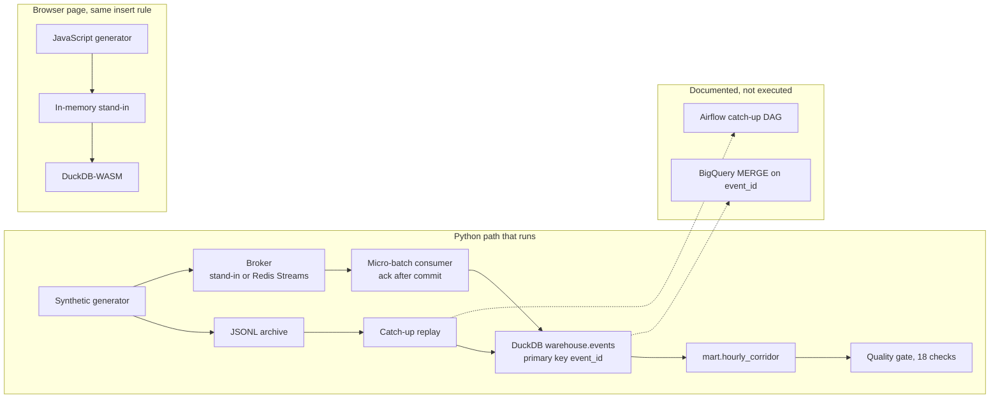
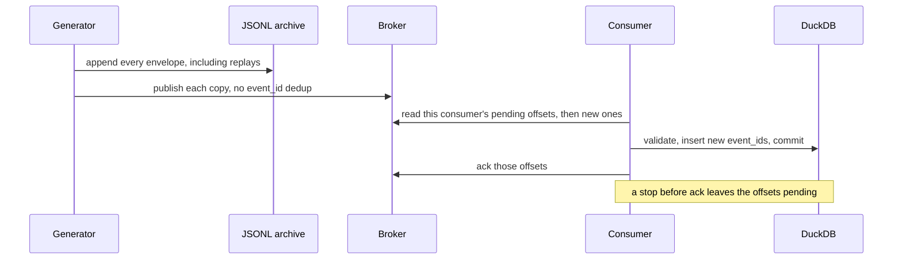
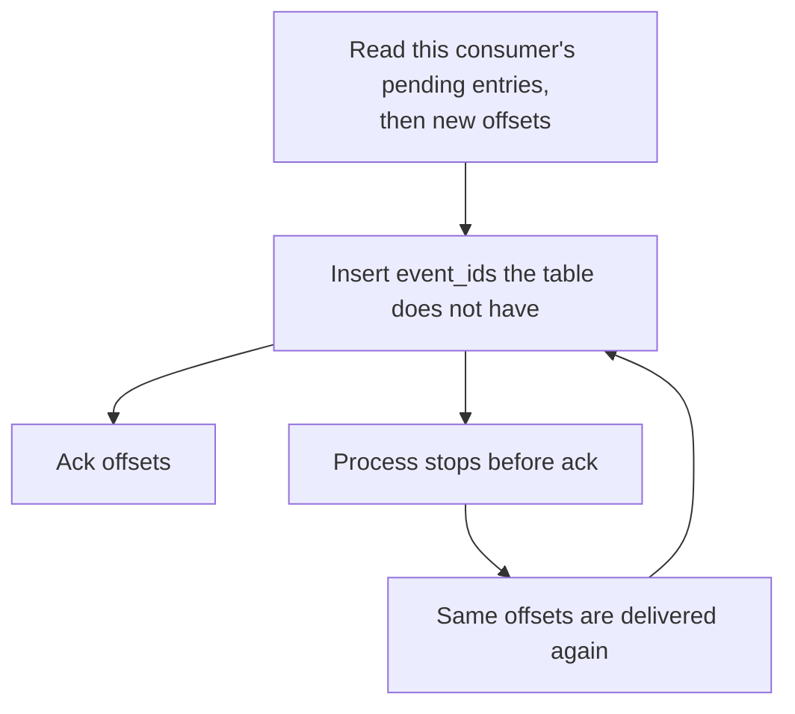
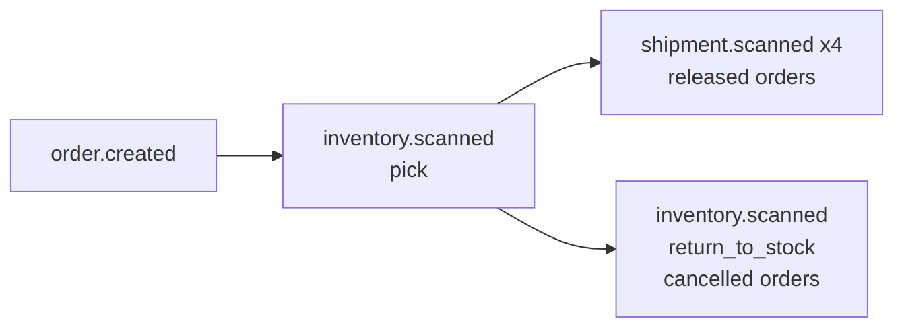

# Andén Sur streaming warehouse

A local reference for landing an at-least-once event stream in a warehouse: one row per `event_id`, an ack only after that row commits, and late events flagged from the stream watermark. The feed is synthetic.

**Site:** https://eflores1122.github.io/streaming-events-warehouse/

Reference implementation by **Edgar Flores**, Data & AI Engineer (Mexico).

Andén Sur is a fictitious Mexican e-commerce fulfillment floor. Andén Sur is not a real company. Nothing here describes an employer, a client, or a production system. Orders, inventory scans, shipment scans, hubs, and customer references are synthetic. The pipeline does not call GCP or AWS. No GCP project and no credentials are required.

## Problem

A floor emits three kinds of facts: an order is opened, a picker scans a bin, a carton is scanned between hubs. The transport delivers those facts at least once. The same `event_id` can be published twice, a consumer can die after the warehouse commit and before the ack, and a delivered scan can carry an `event_time` that sits hours behind the rest of the stream.

The warehouse still has to keep one row per `event_id`, record that a row was late without consulting the wall clock, and ack a poison message so it does not spin forever. This repository runs that path on a laptop and in the browser. The BigQuery file is the shape that path would take in a cloud warehouse. Nothing in the demo, the browser page, or CI executes it.

## Architecture

Two runtimes share one contract. A third box in the diagram is documentation only.



The Python path is a one-shot micro-batch, not a resident service. `demo` writes the archive, publishes every envelope, consumes until the broker is idle, rebuilds the mart, and runs the quality gate. The browser does the same steps in one page session: it publishes into an in-memory stand-in, applies each batch to DuckDB-WASM, acks that batch, then compacts and checks. Redis, BigQuery, and Airflow stay off the page.

The dashed boxes are not clients. [`src/andensur/sql/bigquery_events.sql`](src/andensur/sql/bigquery_events.sql) is a target shape. [`dags/andensur_catchup_compact.py`](dags/andensur_catchup_compact.py) is an Airflow DAG you can point at an existing Airflow 2.10 environment. CI does not install Airflow and does not open a cloud warehouse.

### How one micro-batch moves



1. The generator builds a deterministic list. Counts come from the order count. The seed changes merchandise amounts and `Sintetico######` customer references only.
2. The producer writes that list to a JSONL archive, then publishes it. The broker stores both copies of a replayed `event_id`. It does not collapse them.
3. The consumer reads this consumer's pending entries first, then claims idle pending entries, then reads new offsets. The default batch size is 50.
4. It validates the batch, inserts `event_id`s the table does not have, and commits. Ack runs after that commit. A crash before ack leaves the offsets pending. The next read returns them, and the insert writes nothing the second time. The first offset and the first `ingested_at` stay.
5. Invalid envelopes go to `warehouse.rejects` and are acked, so a poison message does not spin. A rejected redelivery uses the same reject id and does not add a second reject row.
6. Compaction deletes and reinserts `mart.hourly_corridor` from `warehouse.events`. The event log is the system of record. Running compaction twice does not change the totals. `compact(connection, hour_start=...)` rebuilds one UTC hour. The `andensur compact` command rebuilds every hour.
7. `andensur dq`, and the end of `demo`, exit non-zero when any check fails.

At-least-once delivery is the assumption. The warehouse primary key is what makes a replay safe.



### One order, in publish order

The broker does not reorder by `event_time`.



Order 0 is cancelled before it leaves the building, so the pick goes back to the bin and there is no shipment. The first three released orders are published in story order, but their `delivered` scans carry `event_time` `2026-11-02T04:00:00Z`, twelve hours before the generator epoch. Those three rows are stored with `late = true`.

### Where each rule lives

| Rule | Python | Browser |
| --- | --- | --- |
| Envelope, three event types, validation | `src/andensur/models.py` | `site/src/validate.js` |
| Deterministic feed | `src/andensur/generate.py` | `site/src/generate.js` |
| Read / ack contract | `src/andensur/broker.py` | `site/src/broker.js` |
| Stand-in log and pending set | `src/andensur/standin.py` | in-memory `StandIn` |
| Redis Streams group, pending, ack | `src/andensur/redis_streams.py` | not on the page |
| Ack after the warehouse commit | `src/andensur/consumer.py` | `consumeAll` in `site/src/main.js` |
| Insert only a new `event_id`, late flag | `src/andensur/warehouse.py` | `site/src/warehouse.js` |
| Mart rebuilt from the event log | `src/andensur/compact.py` | same SQL, in the page session |
| Structural checks and freshness | `src/andensur/quality.py` | `site/src/quality.js` |
| DuckDB DDL and views | `src/andensur/sql/duckdb_schema.sql` | the page loads that file |
| BigQuery `MERGE`, not executed | `src/andensur/sql/bigquery_events.sql` | link only |
| Archive replay | `src/andensur/catchup.py` | the page replays by publishing again |
| Optional hourly DAG | `dags/andensur_catchup_compact.py` | not on the page |

CI diffs the JavaScript generator against `python -m andensur generate` for 1, 2, 40, and 120 orders. The reference counts below are the CLI measurement.

## Tech stack

| Piece | What this repo uses |
| --- | --- |
| Language | Python 3.11+ (CI uses 3.12) and JavaScript for the page |
| Warehouse | DuckDB file locally, DuckDB-WASM in the browser |
| Broker | Pure-Python stand-in by default. Redis Streams in Compose and in CI |
| Batch safety net | JSONL archive replay. Optional Airflow TaskFlow DAG, not installed here |
| Cloud shape | BigQuery SQL in-repo. No client library, no credentials |
| Checks | pytest, Ruff, GitHub Actions. The page is built with Vite and Node 22 |

Redis Streams is the Compose broker because consumer groups, pending entries, and ack are server features, and the Python client does not need a native library. The stand-in is the process-free path. It is labeled in the demo output as `stand-in (local consumer-group stand-in; not Redis Streams and not Kafka)`. Redpanda, Kafka, or Pub/Sub would sit behind the same read/ack contract. This repository does not ship a Kafka client.

## Reference run

Seed `42`, `120` orders. Counts do not depend on the seed. Reproduce with the commands in [How to run](#how-to-run). Measured by `python -m andensur demo --orders 120 --seed 42 --fresh`.

| | |
| --- | ---: |
| Orders | 120 |
| Cancelled orders (`i % 10 == 0`, including order 0) | 12 |
| Released orders | 108 |
| Inventory scans (120 picks plus 12 returns) | 132 |
| Shipment scans | 432 |
| Unique events | 684 |
| Published, including 4 exact replays | 688 |
| Warehouse rows after dedup | 684 |
| Duplicates dropped | 4 |
| Late rows | 3 |
| Rejects | 0 |
| `mart.hourly_corridor` rows | 53 |

`order.created` is 120, `inventory.scanned` is 132, and `shipment.scanned` is 432. The 53 hourly mart rows sum back to 684 events and to the 3 late rows.

A second `demo --no-fresh` against the same files publishes 688 again, inserts 0, reports 688 duplicates, and leaves 684 rows.

## Sample event

The first event is order 0.

```json
{
  "event_id": "evt-ord-00000",
  "event_type": "order.created",
  "event_time": "2026-11-02T14:00:00Z",
  "source": "andensur-synthetic",
  "payload": {
    "amount_centavos": 19200,
    "channel": "online",
    "fulfillment": "cancelled",
    "city": "Ciudad de Mexico",
    "currency": "MXN",
    "customer_ref": "Sintetico042000",
    "order_id": "ORD-20261102-00000",
    "sku_count": 1,
    "state": "CDMX"
  }
}
```

`19200` centavos is 192.00 MXN of merchandise on the order. Amounts are whole pesos, `15000 + ((seed + index * 97) % 4000) * 100`.

## Sample output

```text
Anden Sur streaming demo
broker: stand-in (local consumer-group stand-in; not Redis Streams and not Kafka)
orders: 120
seed: 42
published: 688
inserted: 684
duplicates: 4
rejected: 0
warehouse_events: 684
late: 3
mart_rows: 53
mart_event_count: 684
events_by_type:
  inventory.scanned: 132
  order.created: 120
  shipment.scanned: 432
freshness: pass
quality: pass
warehouse: data/warehouse/andensur.duckdb
archive: data/archive/events.jsonl
```

The same command with `--no-fresh` prints `inserted: 0` and `duplicates: 688`, and still prints `warehouse_events: 684` and `quality: pass`.

## Broker

Both backends expose `publish`, `ensure_group`, `read`, and `ack`. Neither deduplicates `event_id`.

| | Redis Streams | Stand-in |
| --- | --- | --- |
| Where | `docker compose`, or `--broker redis` | default `--broker stand-in` |
| Group | `XGROUP CREATE ... ID 0` | cursor stored in `state.json` |
| Pending | `XREADGROUP` id `0`, then `XAUTOCLAIM` | this consumer's pending list, then idle claim |
| New records | `XREADGROUP` id `>` | offsets at the cursor |
| Dedup of `event_id` | no | no |

The group is created at id `0`, so a group created after the first `XADD` still sees those entries. `--fresh` deletes the Redis key `andensur.events` and only that key. The stream name, group, and consumer are `andensur.events`, `andensur-warehouse`, and `warehouse-1`.

The stand-in writes `messages.jsonl` plus `state.json` under `--standin-root`. An `fcntl` lock lets a producer process and a consumer process share that directory on Linux or macOS. An empty read returns immediately. Redis may block for `--block` milliseconds. The consumer treats both as an idle poll.

## Idempotency and late events

The late flag does not use the wall clock. The watermark is the maximum `event_time` seen, including the current micro-batch. A row is late when `event_time` is strictly older than that watermark minus 6 hours. Replaying the file on another day does not mark the whole file late, and a replay does not rewrite `late` on a row that is already stored.

The generator clock is `2026-11-02 16:00:00` UTC. Orders are spread over the two hours before that. The three late delivered scans are the exception above. Every other event sits inside that two-hour spread, which is inside the 6-hour window.

Timestamps in the warehouse are naive UTC. Mexico City civil time is `event_time` minus 6 hours. The country is on UTC−6 without daylight saving for this calendar. Views expose `event_time_mx` and `business_date`. The late delivered scan `evt-scn-00001-3` falls on business date `2026-11-01` (22:00 local). Order 0 falls on `2026-11-02`.

`mart.hourly_corridor` is grouped by the UTC hour, `event_type`, and `city`.

## Warehouse

| Relation | Grain | Role |
| --- | --- | --- |
| `warehouse.events` | one accepted `event_id` | system of record |
| `warehouse.orders` | view, `order.created` | amount, channel, customer reference, Mexico City business date |
| `warehouse.inventory_scans` | view, `inventory.scanned` | sku, bin, quantity, pick or return |
| `warehouse.shipment_scans` | view, `shipment.scanned` | hub, scan type, business date |
| `warehouse.rejects` | one bad offset | poison messages that were acked |
| `warehouse.ingest_batches` | one micro-batch | received, inserted, duplicates, late inserts, rejects |
| `warehouse.stream_state` | one watermark | max `event_time` |
| `mart.hourly_corridor` | hour, event type, city | counts and summed centavos |

Customer references match `Sintetico######`. The consumer rejects any other shape, and it rejects a `source` other than `andensur-synthetic`. Order merchandise amounts are integer centavos of MXN.

## Data-quality gate

`demo` and `dq` run 18 checks. A failed check is a data error. Freshness is separate from lateness: it compares `max(ingested_at)` with the check clock, not with `event_time`.

| Check | Fails when |
| --- | --- |
| `events_present` | the event table is empty |
| `event_id_unique` | `event_id` is repeated |
| `required_not_null` | `event_id`, `event_type`, `event_time`, `ingested_at`, or `order_id` is null |
| `event_type_accepted` | `event_type` is not `order.created`, `inventory.scanned`, or `shipment.scanned` |
| `amount_non_negative` | `amount_centavos` is present and negative |
| `currency_mxn` | an order is not MXN |
| `order_channel` | channel, fulfillment, customer reference, or `sku_count` is outside the contract |
| `order_id_unique` | two `order.created` rows share an `order_id` |
| `inventory_shape` | a scan is not `pick` or `return_to_stock`, or sku, bin, hub, city, or a positive quantity is missing |
| `inventory_has_order` | an inventory scan has no `order.created` row |
| `order_has_pick` | an order has no inventory pick |
| `scan_shape` | the scan type is unrecognized, or shipment id, hub, or city is missing |
| `scan_has_order` | a shipment scan has no order row |
| `released_has_shipment` | a released order has no shipment scan |
| `cancelled_has_return` | a cancelled order has no `return_to_stock` scan |
| `cancelled_has_no_shipment` | a cancelled order has a shipment scan |
| `mart_matches_events` | mart `event_count` or `late_count` disagrees with the event log |
| `ingest_freshness` | `max(ingested_at)` is missing or older than 15 minutes |

An empty warehouse fails freshness. A file loaded last week fails freshness even when every `event_id` is unique. That is the ingest SLA, not a judgment about the generator clock.

## BigQuery target shape

Committed mode of the Storage Write API is at-least-once. Append into `events_staging`, then run the `MERGE` in the SQL file: `ON event_id`, `WHEN NOT MATCHED THEN INSERT`. A default stream can pin offsets for exactly-once delivery inside that stream. This demo does not emulate offset tokens. Legacy `tabledata.insertAll` `insertId` deduplicates for a short best-effort window only. `insertId` is not the warehouse guarantee. The guarantee is `event_id`, here as a DuckDB primary key and in the target file as that `MERGE`.

The target table is `PARTITION BY DATE(event_time)` and `CLUSTER BY event_type`. Replace the `PROJECT` placeholder before anyone runs the file by hand. This repository never does.

## Catch-up and the optional DAG

The producer writes every published envelope, including the four replays, to the JSONL archive before it publishes. `andensur catchup` reads that file through the same insert. A second catch-up inserts nothing.

If the stream was published and the consumer never ran, catch-up loads the warehouse, and a later consume of the same stream inserts nothing.

The DAG id is `andensur_catchup_compact`. It replays the archive, rebuilds the mart, and runs the quality gate. `catchup` is false, so enabling it does not replay from `2026-01-01`. `max_active_runs` is 1 because a DuckDB file has one writer. The schedule is `15 * * * *` UTC, which is 09:15 in America/Mexico_City. There is no Airflow task SLA. Freshness is the quality check.

Compose does not start Airflow. CI does not install it. Point an existing Airflow 2.10 environment (Python 3.11 or 3.12) at `dags/` and install this package there. `ANDENSUR_WAREHOUSE` and `ANDENSUR_ARCHIVE` override the default paths under `data/`.

## Synthetic feed

| Event | When it is emitted | Notes |
| --- | --- | --- |
| `order.created` | one per order | `online` for `i % 10 < 7`, otherwise `store`. Cancelled when `i % 10 == 0`. |
| `inventory.scanned` | one pick per order, plus a return on cancelled orders | sku `SKU-NNNN`, bin `BIN-HUB-NN`, quantity equals `sku_count` |
| `shipment.scanned` | four per released order | `picked_up`, `hub_in`, `out_for_delivery`, `delivered` |

Hubs are `HUB-MEX`, `HUB-GDL`, `HUB-MTY`, `HUB-PBC`, `HUB-MID`, and `HUB-QRO`. Cities and states on the events are ASCII corridor keys: Ciudad de Mexico, Guadalajara, Monterrey, Puebla, Merida, Queretaro. They are not a gazetteer. No message contains an email address or a real name.

The four replay copies are the first four envelopes, appended again with the same `event_id`. The broker stores both copies. The warehouse keeps one.

## How to run

Python 3.11 or newer. CI uses 3.12. Dependencies live in `pyproject.toml`. The browser lockfile is `site/package-lock.json`.

```bash
python3.12 -m venv .venv
source .venv/bin/activate
pip install -e ".[dev]"
```

Lint and test (DuckDB and the stand-in; Redis is used when it is reachable):

```bash
ruff check .
ruff format --check .
pytest
```

The one-command warehouse, stand-in broker, no Docker:

```bash
python -m andensur demo --orders 120 --seed 42 --fresh
```

`--fresh` is the default for `demo`. It replaces the local DuckDB file and the stand-in directory so the printed counts match the table above. The report ends with `quality: pass`.

Idempotent second pass:

```bash
python -m andensur demo --orders 120 --seed 42 --no-fresh
```

Split the same path:

```bash
python -m andensur generate --orders 120 --seed 42
python -m andensur produce --broker stand-in --orders 120 --seed 42
python -m andensur consume --broker stand-in
python -m andensur compact
python -m andensur dq
python -m andensur catchup
```

Query the file:

```bash
python - << 'PY'
import duckdb
con = duckdb.connect("data/warehouse/andensur.duckdb", read_only=True)
print(con.execute(
    "select event_type, count(*) from warehouse.events group by 1 order by 1"
).fetchall())
print("late", con.execute("select count(*) from warehouse.events where late").fetchone()[0])
PY
```

`data/` is gitignored. A clean checkout has no warehouse file until the first command writes one.

### Browser page

Node 22. The dev server serves the static session. The first pipeline run downloads the DuckDB module.

```bash
cd site
npm ci
npm run dev
```

`npm run build` writes `site/dist`. GitHub Actions uploads that directory with `actions/upload-pages-artifact` and deploys it with `actions/deploy-pages` on a push to `main`. The warehouse in the page lives in memory. Reloading the page clears it.

### Docker Compose

Redis 7 and a one-shot pipeline. The pipeline container runs the same `demo` command with `--broker redis` and `--fresh`.

```bash
docker compose up --build --abort-on-container-exit --exit-code-from pipeline
```

The warehouse and the archive are written under `./data`. Redis is published on port 6379. The image installs the `redis` extra. It does not install Airflow.

Without Compose, against a Redis you already have:

```bash
pip install -e ".[redis]"
python -m andensur demo --broker redis --redis-url redis://127.0.0.1:6379/0 --orders 120 --seed 42 --fresh
```

## Tests and CI

GitHub Actions (`.github/workflows/ci.yml`) runs on Python 3.12. The job starts Redis 7, installs `.[dev]`, runs Ruff, runs `pytest`, and then runs the generator and consumer smoke test:

```bash
python -m andensur demo --orders 40 --seed 42 --fresh --broker stand-in
```

The workflow has no secrets and does not call a cloud warehouse. `ANDENSUR_REQUIRE_REDIS=1` makes the Redis test fail instead of skip. Locally, without Redis, that test skips and the stand-in suite still runs.

A second job installs the package, diffs the browser generator against `python -m andensur generate` for 1, 2, 40, and 120 orders, and builds `site/`. The Pages workflow is separate and only deploys from `main`.

Covered cases: generator counts, exact seed-42 sample, primary-key dedup inside a batch and across batches, rollback when the batch record fails, pending redelivery, two consumers splitting offsets, claim of an unacked batch, reject-and-ack, freshness pass and fail, a bad inventory quantity, idempotent compaction, archive catch-up followed by a stream consume, the CLI exit code, the BigQuery file's `MERGE` and partition clause, and the DAG's `catchup=False` / `max_active_runs=1` contract.

## Layout

```text
src/andensur/                 generator, brokers, consumer, DuckDB, quality
src/andensur/broker.py        read / ack contract shared by both backends
src/andensur/standin.py       local consumer-group stand-in
src/andensur/redis_streams.py Redis Streams backend
src/andensur/sql/             DuckDB DDL, and the BigQuery target shape
dags/andensur_catchup_compact.py
site/                         Vite page: generator, stand-in, DuckDB-WASM
site/scripts/dump-events.mjs  JSONL dump CI diffs against the Python generator
tests/                        dedup, redelivery, freshness, smoke, contracts
docker-compose.yml            Redis Streams and the one-shot pipeline
Dockerfile
.github/workflows/ci.yml      lint, pytest, Redis, generator parity, site build
.github/workflows/pages.yml   deploy site/dist from main
```

## Limitations

- The company, the orders, the hubs, and the customer references are synthetic. There is no production feed behind this repository.
- The runnable warehouse is one DuckDB file with one writer. It is not BigQuery, and this repo does not run the Storage Write API.
- The default broker is a directory of JSON files. It copies the read/ack rules the tests need. It is not Redis Streams and not Kafka.
- Compose and the Redis extra are the only broker process. There is no Kafka client.
- The Airflow DAG is not started by Compose and is not imported by CI.
- Freshness is a 15-minute ingest SLA. It will fail a correct file that was loaded last week.
- The page session is memory only. It does not speak to the Python process or to Redis.
- `--fresh` on Redis deletes the stream key `andensur.events` and no other key.
- Cities are corridor keys used for grouping. They are not a gazetteer, and amounts are a formula, not a catalog.

## License

[MIT](LICENSE). Copyright 2026 Edgar Flores.
